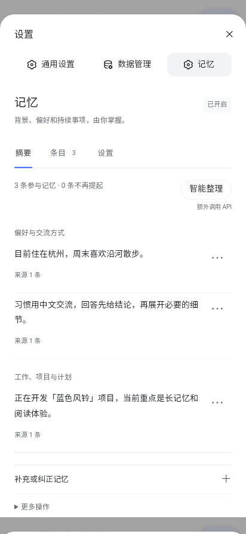
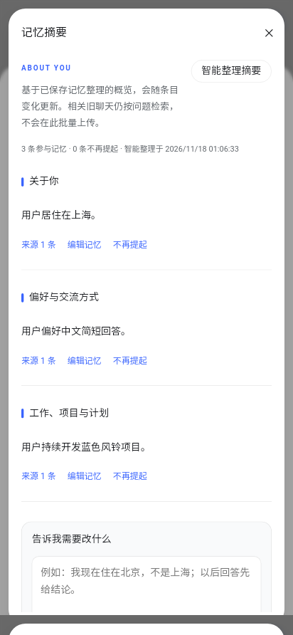
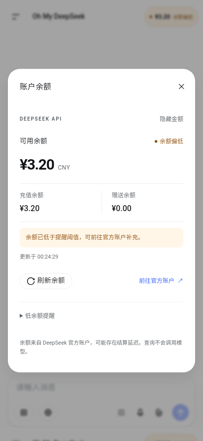
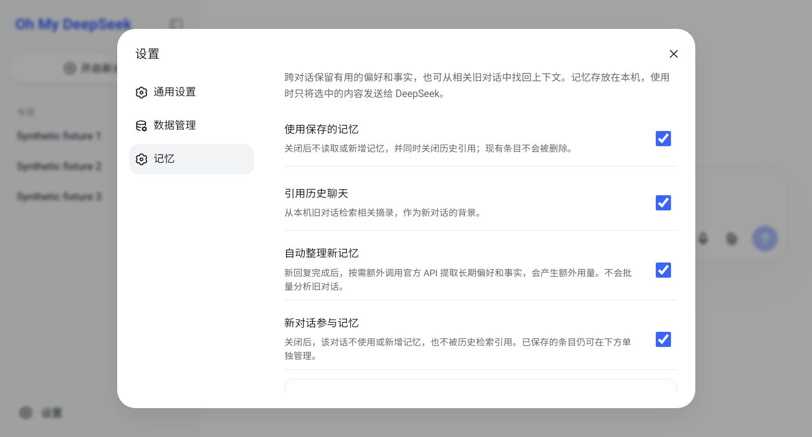
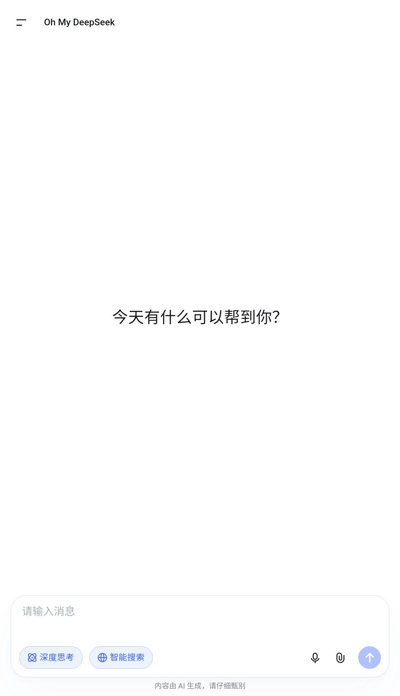

# 验证记录

日期：2026-11-17。测试对象为 BlueStacks Android 9 / API 28 虚拟机，通过 `127.0.0.1:5555` 连接；WebView 为 Chrome 129。没有进行物理手机实测。

## 已完成

| 检查 | 结果与证据范围 |
| --- | --- |
| TypeScript / oxlint | `npm run type` 和 `npm run lint` 通过，0 错误、0 警告 |
| 网页资源 | `npm run build` 通过，资源随 APK 打包 |
| Android | `assembleDebug`、`lintDebug` 通过；JavaScript 开启的通用 Lint 提示保留，React 聊天界面需要 JavaScript。限制导航到本地资源，外链交给外部浏览器，CSP 禁止第三方脚本和子框架 |
| 安装与启动 | APK 安装成功，横屏与竖屏均能显示；截图见下方 |
| 官方网络 | 从虚拟机请求官方 `GET /models`，测试用无效 Key 收到 HTTP 401。后续探测也遇到一次 15 秒超时，未据此认定网络持续稳定 |
| 密钥 | 本地测试字符串经原生存储写入，杀进程重启后仍能正确读取；网页 localStorage 无此密钥。存储实现含加密后解密校验，失败不报告保存成功 |
| 长输入 | 输入 50,001 个中文字，模拟接口收到完整 50,001 字，无客户端 4 万字截断 |
| 思考和搜索 | 实际前端构建的请求带 thinking enabled、deepseek_web_search 和 deepseek_read_url；接收本地 SSE fixture 验证，不代表真实搜索验收 |
| 流式和 Markdown | 故意跨 UTF-8 字节与 SSE 帧边界分片，中文和粗体 Markdown 正常；无未捕获运行时异常 |
| 旧对话 | 将本地会话创建/更新时间设置为 30 天前，重载、选择并继续发送；模拟请求中保留之前的 user/assistant 上下文 |
| 返回键 | 关闭设置弹窗，保留既有弹窗确认逻辑 |
| 原生文件 | 从 Blob 发起系统保存，下载目录生成含中文的测试文件，内容一致；取消保存正确返回取消状态。系统文件选择器重新选中该文件后，WebView 能读取相同内容 |
| 麦克风权限 | Android 权限弹窗出现，拒绝后返回 NotAllowedError。授权时该虚拟机返回 NotReadableError，未拿到可用音轨 |

自动化复验：`node scripts/android-smoke.mjs`。原始 JSON 和中间截图保存在本机被 Git 忽略的 `evidence/local/`。所有聊天输出均为本地模拟响应，脚本拒绝覆盖真实凭据或已有对话，并清理测试对话和测试密钥。

原生文件检查使用 `scripts/check-native-dialogs.mjs`，需通过 Android 系统界面选择/保存；只读诊断工具为 `scripts/inspect-webview.mjs`。这些工具仅连接本应用的 debug WebView。

## 尚未完成

- 初版未使用有效 Key 调用收费模型。0.2.0 已补充官方模型的记忆提取与召回合成样本验证；付费搜索、文件解析、ASR 和 TTS 仍未完成真实接口全流程验收。
- BlueStacks 未能提供可读麦克风音轨；录音、ASR 和实际朗读需在有可用音频设备及有效 Key 的环境继续验证。
- 历史 ZIP 导入/导出的归档逻辑沿用上游；系统文件保存/读取已实测。历史大文件的本地导入已补充验证，复杂文档的官方 API 解析仍未端到端验收。
- APK 为调试签名；未配置发布签名、应用商店上架、自动升级或后台持续生成服务。

## 0.1.1：导入反馈修复

旧版确认导入后仅禁用按钮，没有读取或解析状态，设置关闭后局部状态也会丢失。修复包括：确认页显示文件名和大小；读取、校验、目录、解析、保存各阶段反馈；按实际 ZIP 目录项目数与压缩数据读取量更新进度；显示已解析的对话及图片数；成功与失败的持续提示及通知；设置关闭重开后保留结果。导入执行期间阻止误关闭设置。

回归命令（独立包，与实际使用的 App 数据隔离）：

```powershell
cd android
.\gradlew.bat assembleDebug -PisolatedImportTest
cd ..
adb -s 127.0.0.1:5555 install -r android/app/build/outputs/apk/debug/app-debug.apk
adb -s 127.0.0.1:5555 shell am start -n app.ohmydeepseek.android.importtest/app.ohmydeepseek.android.MainActivity
$env:ANDROID_APP_ID='app.ohmydeepseek.android.importtest'
node scripts/import-feedback-smoke.mjs
```

该命令在旧版本的实际导入代码路径上捕获到 `hasProgress:false / hasReadingText:false / busyButton:false`。修复后通过：延迟文件读取时持续反馈、实际 ZIP 成功导入与数量提示、执行期间保持设置可见、损坏文件提示具体原因并保留原记录、设置关闭重开后保留结果。另在独立包中使用本地大档案完成真实文件选择、解析与入库；未调用模型 API，原始档案和相关截图均不提交仓库。

## 0.2.0：跨会话记忆

新增独立本机记忆库、可管理的保存条目、本机历史文字索引、自动提取和更新、来源展示、总开关/历史开关/自动开关、单对话排除和独立 JSON 备份。详见 [记忆实现与限制](MEMORY.md)。

纯逻辑测试 9 项与独立 Android WebView 集成测试 14 项通过。集成测试使用本地模型 fixture，覆盖请求中的实际记忆注入、跨会话、更新替换、来源、关闭/排除、遗忘与删除、并发清空后不复活、备份去重和重启持久化。另用两次实际官方 API 请求验证记忆提取和随后召回；只发送人工测试文字，不读取用户私有历史，不修改实际记忆库。成功请求合计 504 token。

主 App 从 0.1.1 覆盖升级至 0.2.0 后，525 个已有对话数量不变，原生保存的 API Key 仍已配置，输入框可用。未清除主 App 数据。

## 0.2.1：角色图标

采用确认后的第二版蓝发鲸尾女仆图标，新增 Android 自适应彩色图层、单色主题图层、网页 favicon 与 README 图标。前景位于中央安全区域，以适应系统遮罩。图源、重新生成方式见 [图标资源](../assets/branding/README.md)。

TypeScript、oxlint、网页构建和 Android 全新构建/`lintDebug` 通过；Lint 保留原有必需的 JavaScript 提示。BlueStacks Android 9 桌面已实际显示新图标，覆盖升级后 526 个对话与已配置密钥保留；WebView 读取到 96 × 96 favicon。Android 13 及以上单色主题层已打包，尚未在对应系统实机验证。

## 0.3.0：账户余额与提醒

按用户指定的设计参考流程新增侧栏余额卡、手机顶栏入口和明细弹窗；支持充值/赠送拆分、金额隐藏、自定义低余额阈值、异常提示与刷新。设计观察、接口及缓存行为见 [余额说明](BALANCE.md)。

13 项纯逻辑测试（含 4 项余额测试）、18 项独立 Android WebView 余额流程测试和 14 项记忆回归通过；TypeScript、oxlint、网页构建、Android 构建及 Lint 通过，保留原有 JavaScript 通用提示。余额流程测试使用人工数据，包含 320/412 px 视口模拟、中英文、深色模式、长金额、错误保旧、换 Key 防串号和并发刷新；不是物理手机实测。

主 App 覆盖升级后 526 个对话与原有密钥保留。已在实际 App 中成功读取官方余额并显示明细；验收记录只记成功状态，不记录真实金额或密钥。没有为此调用收费模型。

## 0.4.1 记忆页面

Android WebView 中用人工样例检查摘要、条目与设置。在 320、412 和 1280 px 视口检查深浅主题、长文本换行、菜单定位、键盘导航、搜索无结果、空状态与整理失败反馈。20 项逻辑测试、16 项摘要流程、14 项长记忆回归、9 项界面检查通过。正式包已在模拟器覆盖安装，526 个对话与 API Key 配置保留。

复验命令为 `$env:ANDROID_APP_ID='app.ohmydeepseek.android.importtest'; node scripts/memory-layout-smoke.mjs`。脚本只操作独立测试包，模型响应为本机模拟。



## 0.4.0：记忆摘要

新增本机主题概览、可选智能整理、原条目编辑、划选/文字纠正预览、不再提起及删除并关闭。摘要绑定原条目快照，不独立充当新的个人事实；详见 [记忆摘要说明](MEMORY_SUMMARY.md)。

20 项逻辑测试、16 项独立 WebView 摘要流程测试、14 项长记忆回归、18 项余额流程及 5 项导入反馈检查通过。已检查手机 320/412 px 视口与深色模式。模型响应为本地 fixture；另用实际官方 API 发送人工资料，得到三条摘要与一个居住地纠正，发现省略空数组的兼容情况后修复，并通过同一实际响应回放。没有读取私有档案进行收费测试。

TypeScript、oxlint、网页构建、Android 构建与 Lint 通过。主 App 从 0.3.0 覆盖升级至 0.4.0，526 个对话、已配置密钥和保存记忆数量保留。当前主 App 保存记忆数为 0，已实际检查摘要空状态；不会为了填充摘要自动批量上传旧聊天。

## 截图

记忆摘要来自独立测试包，内容为人工资料：



余额页来自独立测试包，金额为人工 fixture：



以下是虚拟机中实际运行的 Android WebView 页面，不是设计图。记忆页仅使用人工样例，主页截图的聊天记录和测试密钥已清除。




